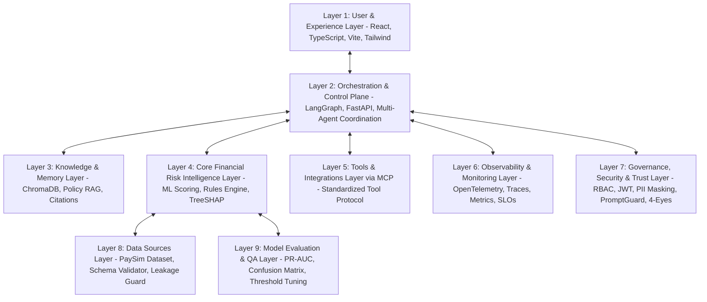

# FinGuard: Enterprise 9-Layer Architecture Specification

FinGuard is an autonomous financial risk intelligence and fraud investigation system built according to an enterprise-grade nine-layer architecture.

---

## Layer 1 — User & Experience Layer
- **Framework**: React 19, TypeScript, Vite, Tailwind CSS v4, Recharts, Lucide Icons.
- **Enterprise Views**:
  1. *Executive Risk Overview*: Real-time portfolio risk telemetry, ground-truth label tracking, temporal transaction curves.
  2. *Transaction Intelligence*: Interactive search, multi-factor filtering, column sorting, pagination, and slide-over forensic ledger inspection with SHAP feature attributions.
  3. *Investigation Workbench*: Queue prioritization, 9-Agent workflow trace timeline, RAG policy citations, and 4-Eyes human-in-the-loop review disposition actions.
  4. *AI Risk Assistant*: Natural-language copilot powered by Groq LLM grounded in indexed AML/KYC policies.
  5. *Model Intelligence*: Empirical test-set confusion matrices, PR-AUC analysis, threshold cost curves, and global feature importance.
  6. *Governance & Audit*: Immutable event audit stream with correlation tracking and server-side RBAC matrix.
  7. *Observability Center*: OpenTelemetry distributed span traces, API latencies, token counters, and SLO monitoring.
  8. *System Administration*: Infrastructure status, interactive MCP tool runner console, and knowledge base registry.

---

## Layer 2 — Orchestration & Control Plane
- **Framework**: LangGraph stateful multi-agent workflow runtime on FastAPI.
- **Specialized Multi-Agent Collective**:
  1. *Supervisor Agent*: Interprets intent, manages workflow state, assigns correlation IDs, and dynamically routes transactions.
  2. *Transaction Intake Agent*: Ingests raw or persisted transactions with strict validation.
  3. *Data Quality Agent*: Audits balance boundaries and verifies target leakage isolation.
  4. *Fraud Detection Agent*: Executes trained Random Forest model inference and deterministic fraud rules.
  5. *Risk Assessment Agent*: Computes composite risk score (0-100) and triggers human-review checkpoints.
  6. *Investigation Agent*: Analyzes behavioral flags, account liquidation deltas, and counterparty relationships.
  7. *Policy & Compliance Agent*: Queries Chroma vector store and grounds findings in regulatory directives.
  8. *Explainability Agent*: Synthesizes objective, non-speculative risk narratives using TreeSHAP attributions and Groq LLM.
  9. *Audit & Reporting Agent*: Compiles structured forensic dockets and seals persistent audit events.

---

## Layer 3 — Knowledge & Memory Layer
- **Vector Database**: ChromaDB (persistent embedded store with all-MiniLM-L6-v2 embeddings).
- **Compliance Corpus**:
  - `AML-04`: Anti-Money Laundering & Rapid Liquidation Procedures.
  - `FTP-01`: Financial Fraud Typologies & Investigation Playbook (Account Takeover, Mule Networks).
  - `REG-KYC-AML-2024`: Reserve Bank of India & Basel Committee AML Master Direction.
  - `GOV-AI-2024-09`: FinGuard Enterprise Model Governance & Human-in-the-Loop Policy.
- **Source Attribution**: Transparent document ID, section name, relevance score, and excerpt citations.

---

## Layer 4 — Core Financial Risk Intelligence Layer
- **Engine**: Scikit-Learn `RandomForestClassifier` (100 estimators, balanced subsampling).
- **Rule Engine**: Deterministic rules for account liquidation drain (`RULE_LIQUIDATION_DRAIN`), ledger discrepancies (`RULE_LEDGER_INCONSISTENCY`), large-value exposure (`RULE_HIGH_VALUE_THRESHOLD`), and merchant safeguards.
- **Explainability**: SHAP `TreeExplainer` computing positive and negative feature impacts for every scored transaction.

---

## Layer 5 — Tools & Integrations Layer via MCP
- **Standard**: Model Context Protocol (MCP) compliant server tools.
- **Tools**:
  - `lookup_transaction`: Transaction retrieval and risk flags.
  - `lookup_account`: Synthetic behavioral profiling.
  - `calculate_risk`: Real-time ML inference and SHAP attributions.
  - `search_policies`: Semantic retrieval of compliance procedures.
  - `create_investigation_case`: Docket instantiation.
  - `update_case_disposition`: 4-Eyes disposition recording.
  - `check_synthetic_watchlist`: Mock internal screening list adapter.

---

## Layer 6 — Observability & Monitoring Layer
- **Distributed Tracing**: OpenTelemetry SDK with in-memory span exporter and distributed correlation IDs.
- **Metrics**: Latency percentiles (Average, P95), ML inference latency, agent runtime, error rates.
- **LLM Accounting**: Token consumption and estimated dollar costs ($0.59 / 1M tokens) on Groq provider.
- **SLO Framework**: Availability target 99.9%, Latency target < 250ms.

---

## Layer 7 — Governance, Security & Trust Layer
- **RBAC**: Four granular roles (`analyst`, `investigator`, `auditor`, `administrator`).
- **Authentication**: JWT access tokens (HS256) with password hashing.
- **PII Masking**: Masking of customer account identifiers (`C123***789`).
- **PromptGuard**: Input sanitization blocking jailbreaks and prompt injection attempts.
- **Human-in-the-Loop**: Consequential actions require 4-Eyes human authorization.

---

## Layer 8 — Data Sources Layer
- **Primary Source**: PaySim Synthetic Financial Transaction Dataset (`PS_20174392719_1491204439457_log.csv`).
- **Hygiene**: Strict target leakage isolation preventing `isFraud` and `isFlaggedFraud` contamination.
- **Database**: SQLite (local WAL mode) with PostgreSQL-compatible SQLAlchemy models.

---

## Layer 9 — Model Evaluation & QA Layer
- **Metrics**: PR-AUC (0.9449), ROC-AUC (0.9844), F1-Score (0.9412), Precision (0.9231), Recall (0.9600).
- **Threshold Calibration**: Operational decision threshold set at 0.65.
- **Testing**: Automated PyTest integration and unit test suite covering all 9 layers.
